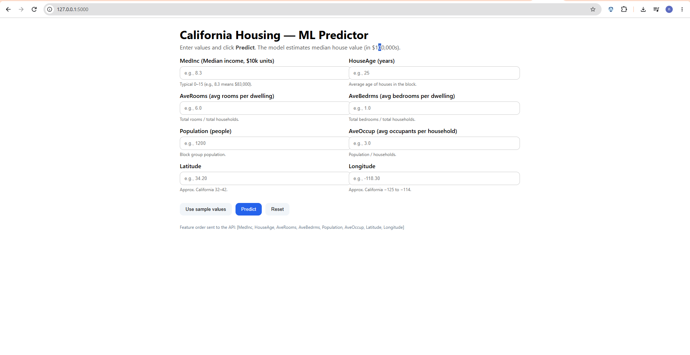

# California Housing — Model as a Service (Flask + Docker)

Lab วิชา CPE312 Intro Data Science: ให้บริการโมเดล RandomForestRegressor (California Housing dataset) ผ่าน Flask API และหน้าเว็บ แล้วรันใน Docker container

## โครงสร้างโปรเจ็ค
```
ml_service/
├─ app.py             # Flask app (/, /health, /predict)
├─ train_model.py     # เทรนโมเดลแล้วบันทึกที่ model/model.pkl
├─ requirements.txt
├─ Dockerfile
├─ templates/
│  └─ main.html       # ฟอร์มรับค่า 8 features
└─ model/             # สร้างอัตโนมัติตอนเทรน (ไม่ push ขึ้น GitHub)
```

## วิธี Build และ Run ด้วย Docker
```powershell
docker build -t ds-ml-service .
docker run --rm -p 5000:5000 ds-ml-service
```
โมเดลจะถูกเทรนอัตโนมัติตอน `docker build` (ต้องต่ออินเทอร์เน็ตเพื่อโหลด dataset)

- หน้าเว็บ: http://127.0.0.1:5000/
- ตรวจสถานะ: http://127.0.0.1:5000/health

## ทดสอบ API
PowerShell:
```powershell
Invoke-RestMethod -Uri http://127.0.0.1:5000/predict -Method Post -ContentType "application/json" -Body '{"features":[8.3,25.0,6.0,1.0,1200,3.0,34.2,-118.3]}'
```
curl / Git Bash:
```bash
curl -X POST http://127.0.0.1:5000/predict -H "Content-Type: application/json" -d '{"features":[8.3,25.0,6.0,1.0,1200,3.0,34.2,-118.3]}'
```
ผลลัพธ์ที่คาดไว้: `{"prediction": 4.03...}` (ประมาณ $403,000)

ลำดับ features: `[MedInc, HouseAge, AveRooms, AveBedrms, Population, AveOccup, Latitude, Longitude]`

## รันแบบไม่ใช้ Docker (ทดสอบในเครื่อง)
```powershell
python -m venv .venv
.venv\Scripts\activate
pip install -r requirements.txt
python train_model.py
python app.py
```

## ผลลัพธ์

